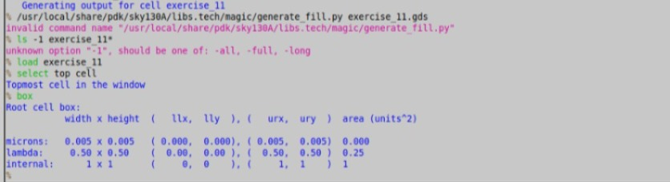
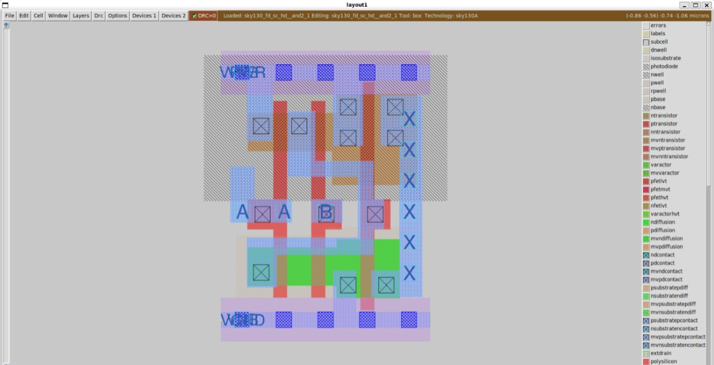

# Lab 0: Tool Installation and Setup

## Objective
Set up a Linux environment on Windows and install the open-source tools needed for the physical verification labs: Magic, Netgen, Xschem, ngspice and the sky130A PDK.

## Environment
- Windows laptop with WSL2, running a separate Ubuntu distro for these labs
- Magic 8.3.685
- Netgen 1.5.325
- Xschem 3.4.8RC
- ngspice 42
- SKY130 (sky130A) PDK, installed with Volare

## Steps

### Step 1: Check that GUI apps work
I installed `x11-apps` and ran `xeyes` to confirm that graphical windows open from WSL.

```bash
sudo apt update
sudo apt install -y build-essential git x11-apps
xeyes
```


*The xeyes window opening shows that WSL can display graphical applications, which Magic and Xschem need.*

### Step 2: Install the tools
I built Magic, Netgen and Xschem from source, and installed ngspice from the Ubuntu package.

```bash
git clone https://github.com/RTimothyEdwards/magic.git
cd magic && ./configure && make && sudo make install
```

The same pattern was used for Netgen and Xschem.

### Step 3: Install the sky130A PDK
I used Volare to download a prebuilt PDK, then linked it to `/usr/local/share/pdk`, the path the labs expect.

### Step 4: Verify the tools
```bash
magic --version
netgen -batch
xschem --version
ngspice --version
ls /usr/local/share/pdk/sky130A
```


*Magic 8.3.685 starts correctly with the sky130A technology.*

## Tool versions verified

| Tool | Version |
|------|---------|
| Magic | 8.3.685 |
| Netgen | 1.5.325 |
| Xschem | 3.4.8RC |
| ngspice | 42 |
| sky130A PDK | installed with Volare |

## Issues faced and fixes

**1. VirtualBox VM would not boot ("no bootable medium found").**
Cause: the new VM had no Ubuntu ISO attached. Fix: switched to WSL2, which needs no ISO and is quicker to set up.

**2. Read-only file system error during a large download.**
Cause: heavy disk writes during the open_pdks download caused I/O errors, and Linux switched the disk to read-only. Fix: restarted WSL, created a fresh Ubuntu distro, and installed the PDK with Volare instead of cloning every library.

**3. Hard-coded paths in `sky130A.magicrc`.**
Cause: Magic closed immediately after starting because the file pointed to a build folder that does not exist on my machine. Fix: changed `PDK_ROOT` to `/usr/local/share/pdk`.

**4. Magic menus missing.**
Cause: `sky130A.tcl` had the same hard-coded path in `TECHPATH`. Fix: pointed it to the installed PDK.

**5. `BadAlloc` display error with `magic -d XR`.**
Fix: used `magic -d X11`.

