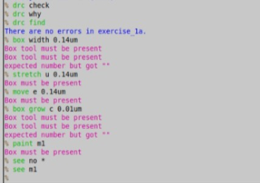
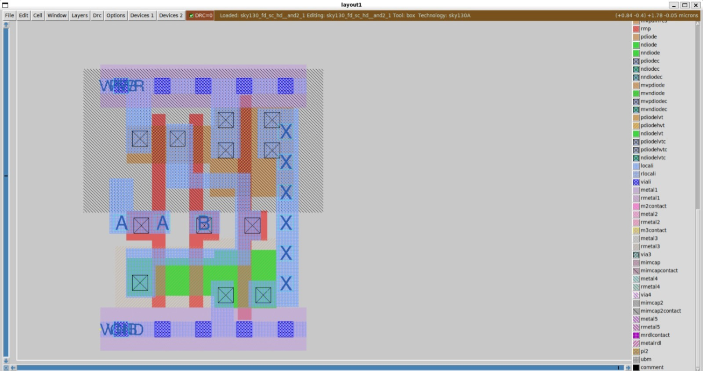

# Lab 1: Inverter Design Flow

## Objective
Go through the basic design flow on sky130A: draw an inverter schematic, simulate it, draw the layout, extract a netlist, and compare the two with LVS.

## Tools
Xschem 3.4.8RC, ngspice 42, Magic 8.3.685, Netgen 1.5.325, sky130A PDK.

## Steps
1. **Set up the folders** (`mag`, `netgen`, `xschem`) and copy the PDK config files: `xschemrc`, `.spiceinit`, `.magicrc` and `sky130A_setup.tcl`.
2. **Check each tool** starts correctly (Magic, Xschem, ngspice, Netgen).
3. **Schematic:** drew the inverter with an nfet and a pfet from the sky130 library in Xschem and set the device sizes.
4. **Simulation:** built a testbench and simulated it in ngspice.
5. **Layout:** drew the inverter layout in Magic.
6. **Extraction:** ran `extract all`, `ext2spice lvs` and `ext2spice` to get the layout netlist.
7. **LVS:** compared the layout and schematic netlists with Netgen.

## Results

