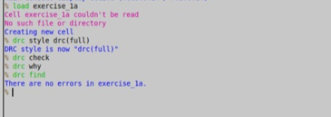
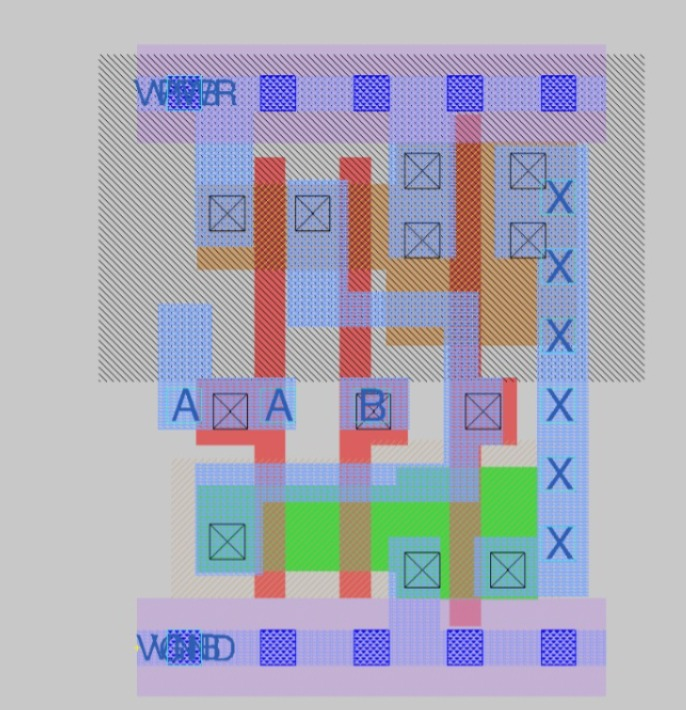

# Lab 2: DRC on the AND2_1 Standard Cell

## Objective
Run a Design Rule Check (DRC) on the standard cell `sky130_fd_sc_hd__and2_1` in Magic, to confirm that the layout follows the sky130A foundry rules.

## Tools
- Magic 8.3.685
- sky130A PDK (`sky130_fd_sc_hd` standard cell library)

## Background
DRC checks that a layout meets the manufacturing rules for each mask layer, such as minimum width, spacing and enclosure. A cell from the foundry's standard cell library is expected to be DRC clean, so this lab also checks that my Magic and PDK setup works.

## Steps

### Step 1: Start Magic with the sky130A technology
```bash
cd ~/vsd/Lab2_fundamentals
cp /usr/local/share/pdk/sky130A/libs.tech/magic/sky130A.magicrc .magicrc
magic -d X11
```
Magic reads `.magicrc` from this folder and loads the sky130A technology.

### Step 2: Read the standard cell library
In the Magic console:
```
gds read /usr/local/share/pdk/sky130A/libs.ref/sky130_fd_sc_hd/gds/sky130_fd_sc_hd.gds
```
This loads all the cells in the library from the GDS file.

### Step 3: Load the AND2 cell
```
load sky130_fd_sc_hd__and2_1
```



The layout window shows the cell. (Describe what you see, such as the layers and the pins.)

### Step 4: Run DRC
```
drc style drc(full)
drc check
drc why
```
- `drc style drc(full)` selects the full rule set.
- `drc check` runs the check.
- `drc why` explains any violation found, and prints nothing useful when there are none.



## Result
No DRC errors were found for `sky130_fd_sc_hd__and2_1`.

