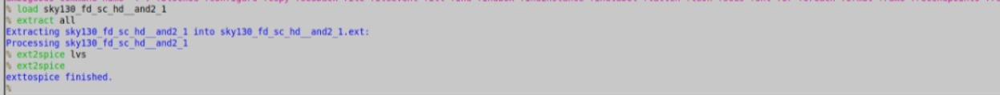
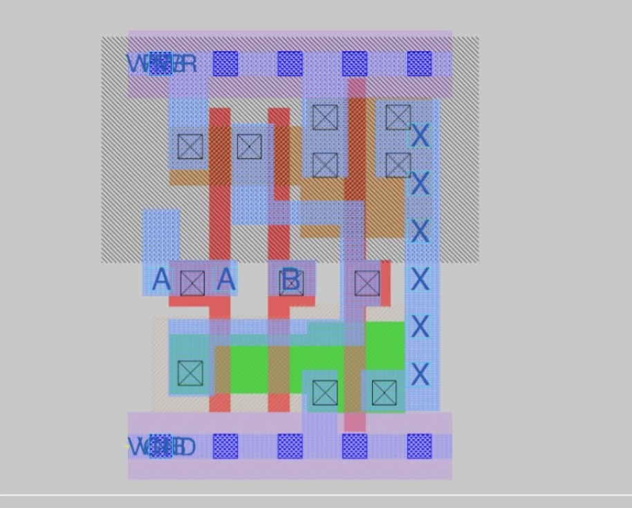
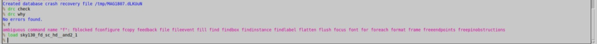

# Lab 3: DRC Issues

## Objective
Find and fix design rule violations in Magic using the sky130A rules, and check the density rules.

## Tools
- Magic 8.3.685 with the sky130A tech file
- `check_density.py` and `generate_fill.py` from the PDK

## Method
For each exercise I loaded the layout, ran DRC, read the violation with `drc why`, fixed the layout, and ran the check again until no errors remained.

```
drc style drc(full)
drc check
drc why
drc find
```

Other Magic commands I used to edit the layout:

```
box width 0.14um
stretch u 0.14um
move e 0.14um
box grow c 0.01um
paint m1
```

## Exercises

| Exercise | Rule checked | What I did | Result |
|----------|--------------|------------|--------|
| 1 | Width, spacing, notch | [what you changed] | [for example: DRC clean] |
| 2 | Vias | [what you changed] | [result] |
| 3 | Minimum area and hole | [what you changed] | [result] |
| 4 | Wells and deep nwell | [what you changed] | [result] |

Delete any row for an exercise you did not do.

### Exercise 1: Width, spacing and notch
[Describe the violation `drc why` reported and how you fixed it.]


*Before: [what the screenshot shows]*


*After: [what the screenshot shows]*


## Density check
I ran `check_density.py` on `exercise_11.gds`. It reported that the layout is smaller than 700 µm x 700 µm, so the density check cannot run on a layout this small. I also ran `generate_fill.py`. Giving it the `.mag` file produced "Project is not a GDS file!", so it needs the `.gds` file.


*[what the screenshot shows]*

## Issues faced and fixes
- **`Project is not a GDS file!`:** the script needs a `.gds` input, not a `.mag` file.
- **`getcell ... couldn't be read`:** the fill file did not exist because the script had failed, so I fixed the script run first.
