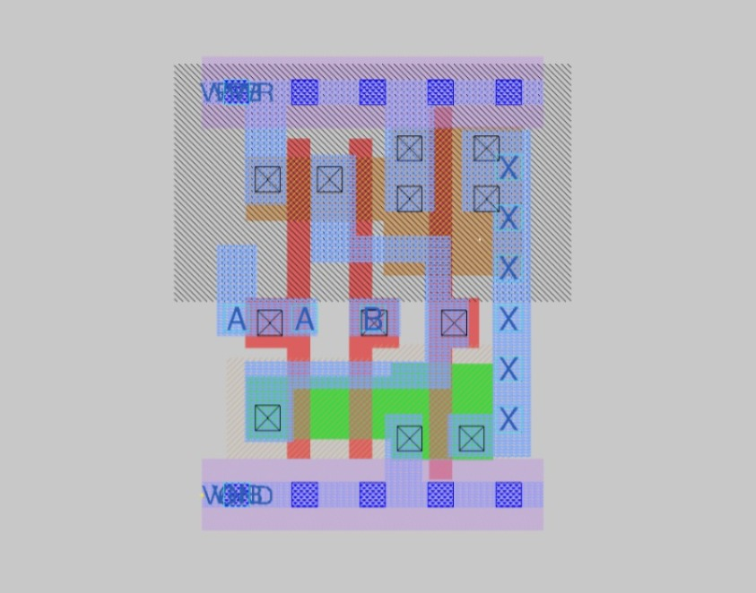
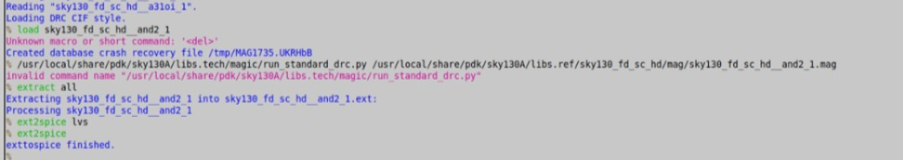
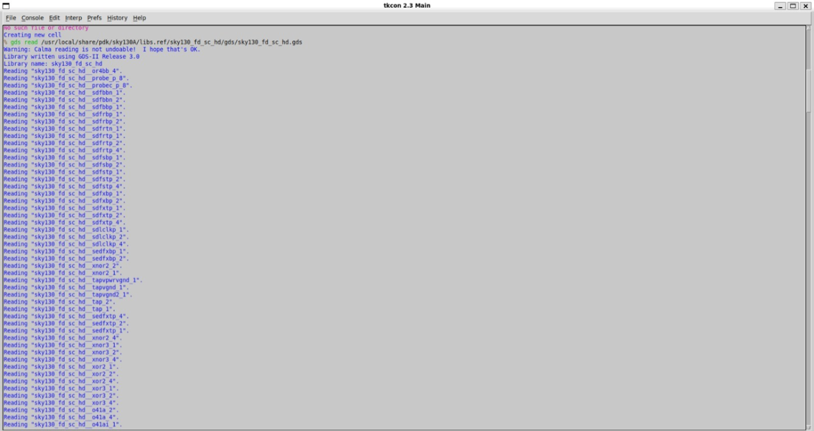
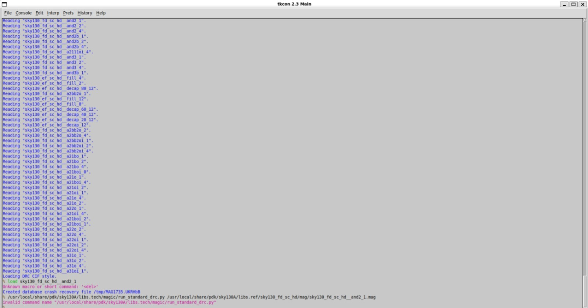

# Lab 4: LVS Exercises

## Objective
Compare layout and schematic netlists with Netgen, and learn to read mismatches in `comp.out`.

## Tools
Netgen 1.5.325 with `sky130A_setup.tcl`.

## Method
```bash
netgen -batch lvs "netA.spice test" "netB.spice test" sky130A_setup.tcl comp.out -json | tee lvs.log
```
For every exercise I ran the comparison, opened `comp.out`, and noted whether I got a match, a net mismatch or a device mismatch.

## Exercises

| Exercise | What it shows | 
|----------|---------------|
| 1 | Net and device mismatch in `comp.out` | 
| 2 | Subcircuit comparison and pin order | 
| 3 | Black-box cells and the `-blackbox` flag | 
| 4 | Permuting the pins of low-level devices | 
| 5 | Extracting netlists from a real design | 
| 6 | Fill cells and `MAGIC_EXT_USE_GDS=1` | 
| 7 | Verilog netlists and power rails | 
| 8 | Missing diode and missing via connections | 
| 9 | Property mismatches (width, length) | 

Delete any row for an exercise you did not do.

### Exercise 1: Net and device mismatch
Netgen does not compare net names. It groups nets that look alike into partitions, so the net mismatch in `comp.out` is usually easier to debug than the device mismatch.


*[what the screenshot shows]*

### Exercise 2: Subcircuits and pin order
A subcircuit definition on its own is not an active component. Only lines that instantiate it count. Changing the pin order inside a subcircuit still matched, but changing pin names at the top level gave a mismatch.


*[what the screenshot shows]*

### Exercise 3: Black-box cells
Empty subcircuits are treated as black boxes, and changing a port name creates proxy pins. The `-blackbox` flag stops Netgen from flattening empty cells.


*[what the screenshot shows]*

### Exercises 4 to 9


*[what the screenshot shows]*


